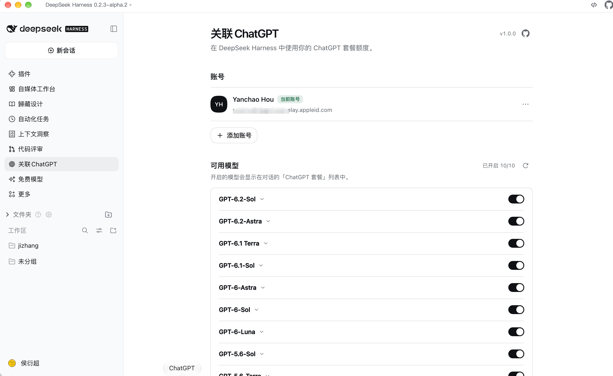

<div align="center">

# dsh-use-chatgpt

**A ChatGPT plan plugin for [DeepSeek Harness](https://www.deepseek.com/harness/)**

Account switching · Model management · Web search

[](https://www.deepseek.com/harness/)
[](./LICENSE)
[](https://github.com/houyanchao/dsh-use-chatgpt/pulls)
[](https://github.com/houyanchao/dsh-use-chatgpt)

[简体中文](./README.md) | **English**



</div>

## 📖 What is dsh-use-chatgpt?

Use your ChatGPT plan allowance in DeepSeek Harness.

## ✨ Features

- **Accounts** — Add an account at the bottom of the account list. Use the controls in an account’s row to switch to it, or open **⋯** to sign out. Signing out deletes that account’s local connection. Adding the same account again creates a new connection. You’ll need to set model visibility again, and plugin conversations tied to the old connection can no longer be continued.
- **Models** — Turn off models you rarely use under **Available models** to hide them from the chat’s model picker. Each account keeps its own settings.
- **Conversations** — Turn on **Web search** at the bottom of the composer to search the web. Depending on the model, you can also adjust reasoning effort, attach images and PDFs for the model to read, or use tools already authorized for the conversation.

## 📦 Installation

### Method 1 (desktop client)

In the [DeepSeek Harness](https://www.deepseek.com/harness/) client, open **Plugins → Add plugin**, enter `dsh-use-chatgpt`, then click **Install**.


### Method 2 (install from npm with the CLI)

```bash
# Install dsh-use-chatgpt
dsh plugin --profile web add dsh-use-chatgpt
```

## ⚙️ Getting started

1. Open **Link ChatGPT** in the sidebar, select **Continue with ChatGPT**, and complete authorization in your browser.
2. Return to the chat, choose a model under **ChatGPT Plan** in the model picker, and send a message.

Your available models and usage allowance depend on what OpenAI authorizes for your account.

## ⭐ Support

If dsh-use-chatgpt is useful to you, give it a 🌟 to help others discover it!

## 📄 License

This project is intended for non-commercial use. The author’s independently written plugin code is licensed under [GPL-3.0-or-later](./LICENSE). The OpenAI DevKit code and documentation are subject to its [non-commercial license](https://github.com/openai/sign-in-with-chatgpt-devkit/blob/0a36fefeb913055c8c7a1a29b63d82b96b2e841a/LICENSE). Commercial use of the DevKit requires separate written permission from OpenAI.

Third-party dependencies retain their respective [licenses and notices](https://github.com/houyanchao/dsh-use-chatgpt/blob/main/notices/THIRD_PARTY_NOTICES.md). Use of the ChatGPT logo follows the [OpenAI brand guidelines](https://openai.com/brand/). The sign-in service is subject to the [Sign in with ChatGPT terms](https://openai.com/policies/sign-in-with-chatgpt-terms/).
