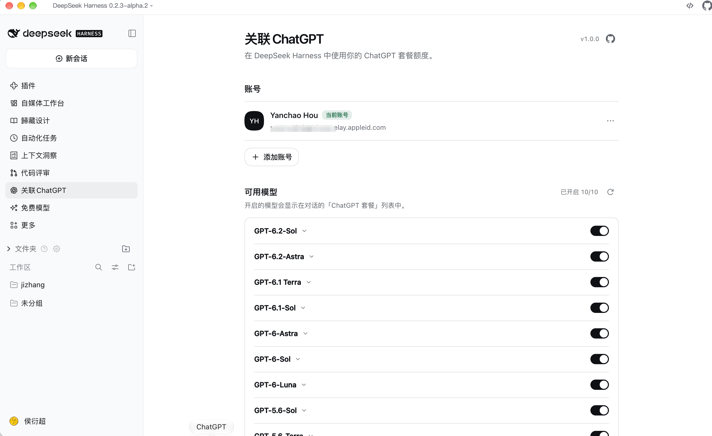

# dsh-use-chatgpt

在 DeepSeek Harness 中使用你的 ChatGPT 套餐额度。当前支持本机 macOS 和 Windows。



## 开始使用

1. 打开侧边栏的「关联ChatGPT」，点击「使用 ChatGPT 登录」，在浏览器中完成授权。
2. 回到对话页，在模型选择器的「ChatGPT 套餐」下选择模型，发送消息即可。

可用模型和套餐额度以 OpenAI 对当前账号的授权为准。

## 常用功能

- **账号**　在账号列表底部添加账号，在对应行切换账号或通过「⋯」退出登录。
- **模型**　在「可用模型」里关闭不常用的模型，即可从对话页的模型列表中隐藏。每个账号单独保存设置。
- **对话**　在输入框底部打开「联网」即可搜索网页。支持的模型还可调整推理等级、读取图片和 PDF，或调用会话中已获准的工具。

## 从源码安装

安装 Node.js（22.19+ 的 22.x 或 24+）和 npm，然后在项目目录打包。在 macOS 上还需要 Xcode Command Line Tools。

```sh
npm ci
npm pack
```

在 macOS 上生成的 `.tgz` 可用于 Apple 芯片、Intel Mac 和 Windows。在 Windows 上打包可生成 Windows 安装包。

本机 Web profile 可运行 `dsh plugin --profile web add <安装包路径>`，然后重启本地服务。支持本地插件调试的桌面客户端可从「开发 → 本地插件调试」导入已构建的项目目录。

官方独立桌面客户端通过插件管理从 npm 安装，测试本地安装包可使用上面的 Web profile。

## 登录与更新

插件按 OpenAI 的公开授权流程登录，通过官方 OpenAI JavaScript SDK 调用 Responses API。账号凭据加密保存在用户的 DeepSeek Harness 数据目录。已有账号沿用原来的加密文件和系统密钥。

`vendor/devkit/` 是[官方 DevKit 源码快照](https://github.com/openai/sign-in-with-chatgpt-devkit/tree/0a36fefeb913055c8c7a1a29b63d82b96b2e841a)，可直接整目录替换。插件自己的登录和对话代码位于 `host/chatgpt/`。更新快照后，请对照[官方接入文档](https://developers.openai.com/siwc/token-sharing-open-source)检查协议变化，并运行 `npm test` 和 `npm run build`。

## 许可证

本项目用于非商业场景。作者独立编写的插件代码采用 [GPL-3.0-or-later](./LICENSE)。OpenAI DevKit 的代码和文档遵循其[非商业许可证](https://github.com/openai/sign-in-with-chatgpt-devkit/blob/0a36fefeb913055c8c7a1a29b63d82b96b2e841a/LICENSE)，商业使用该 DevKit 需另行取得 OpenAI 书面授权。

第三方依赖沿用各自的[许可证与声明](https://github.com/houyanchao/dsh-use-chatgpt/blob/main/notices/THIRD_PARTY_NOTICES.md)。ChatGPT 标识遵循 [OpenAI 品牌指南](https://openai.com/brand/)，登录服务适用 [OpenAI 使用条款](https://openai.com/policies/sign-in-with-chatgpt-terms/)。
